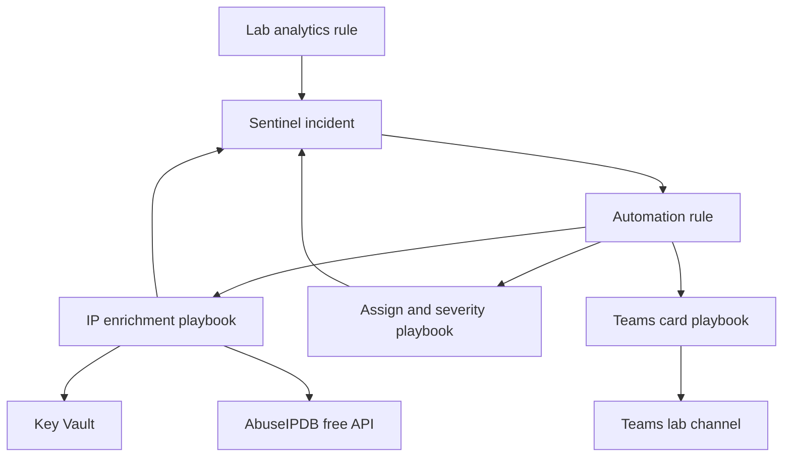

# Sentinel automated incident response

SOAR practice on Microsoft Sentinel for Mosa Mofokeng. The playbooks enrich a new incident, assign it, and post a Teams card. A phishing account takeover runbook sits beside them. You deploy this on the workspace from [Sentinel-Home-SOC-Lab](https://github.com/Sasa021/Sentinel-Home-SOC-Lab), then you add the evidence.

Nothing in this repository is a finding from a live run. Scores, incident numbers, screenshots, and lessons stay blank until you fill them from your tenant.

## What it proves

You can wire a small response loop: an automation rule starts a Logic App that checks an IP with a free threat intelligence API and writes a comment, a second playbook assigns the incident and sets severity, and a third posts an adaptive card to a Teams channel you control. You can also walk a phishing account takeover using the NIST SP 800-61 phases, including revoke sessions, password reset, and block sign-in, and you know that a personal information breach in South Africa may have to be reported to the Information Regulator under POPIA.

The proof is your deployment and your notes. Employers should see your screenshots and the report from the lab you ran.

## Skills and tools

- Microsoft Sentinel automation rules and incidents
- Azure Logic Apps, Consumption plan, deployed from ARM templates
- Managed identity and Azure RBAC, including Microsoft Sentinel Responder
- Azure Key Vault for the API key
- AbuseIPDB free API, with VirusTotal's free public API as an optional swap
- Microsoft Teams adaptive cards
- KQL for Entra sign-in and audit logs
- NIST SP 800-61 incident handling
- POPIA section 22 awareness for South Africa
- Safe test design so a lab rule cannot fan out across every incident

Azure, Logic Apps, Key Vault, and Log Analytics can incur charges. AbuseIPDB's free plan and a Microsoft 365 Developer Program sandbox, if you are eligible, cover the API and Teams without buying a licence. Read the cost section in [docs/lab-guide.md](docs/lab-guide.md) before you deploy. Delete the lab resources when you finish.

## MITRE ATT&CK techniques covered

These are the adversary techniques the runbook and the test incident are built around. They are not detections this repo claims to have produced.

| ID | Name | Where it is covered |
| --- | --- | --- |
| T1566 | Phishing | Runbook scenario and triage |
| T1566.002 | Spearphishing Link | Triage question on links |
| T1078 | Valid Accounts | Account takeover handling |
| T1078.004 | Cloud Accounts | Entra test user and sign-in queries |
| T1621 | Multi-Factor Authentication Request Generation | Sign-in triage |
| T1098 | Account Manipulation | Audit queries, eradication checks |
| T1114.003 | Email Forwarding Rule | Mailbox hunt when `OfficeActivity` exists |
| T1528 | Steal Application Access Token | OAuth consent review |
| T1550.004 | Web Session Cookie | Revoke sessions in containment |

The test analytics rule is tagged Initial Access and T1566 so the lab incident has a tactic. The query is a `print` statement. It does not detect live phishing mail.

## Architecture



The automation rule calls the playbooks in that order and does not wait for a run to finish. The incident remains the place to confirm the comment, the owner, and the severity. Identities: each Logic App has a system assigned managed identity. Enrichment and assign use Microsoft Sentinel Responder. The Teams playbook uses Microsoft Sentinel Reader. Enrichment also has Key Vault Secrets User on the vault. Sentinel itself runs the playbooks as the Azure Security Insights principal with Microsoft Sentinel Automation Contributor on the resource group.

## Repo structure

```
.
├── README.md
├── LICENSE
├── automation-rules/
│   ├── README.md
│   └── lab-incident-creation.json
├── docs/
│   ├── lab-guide.md
│   ├── report-template.md
│   ├── screenshot-checklist.md
│   └── testing.md
├── evidence/
│   └── README.md
├── playbooks/
│   ├── README.md
│   ├── assign-and-set-severity/
│   ├── ip-enrichment/
│   └── teams-adaptive-card/
└── runbooks/
    └── phishing-account-takeover.md
```

`evidence/` has no screenshots yet. Add them with the names in the checklist, after redaction.

## How to reproduce

1. Use the existing Sentinel workspace from Sentinel-Home-SOC-Lab. Do not create a second workspace.
2. Follow [docs/lab-guide.md](docs/lab-guide.md). Plan on about 5 to 6 hours, plus wait time for the first scheduled run.
3. Trigger one synthetic incident with [docs/testing.md](docs/testing.md), then disable the analytics rule and the automation rule.
4. Optionally walk [runbooks/phishing-account-takeover.md](runbooks/phishing-account-takeover.md) against `lab-phish-test` only.
5. Save redacted screenshots under `evidence/` using [docs/screenshot-checklist.md](docs/screenshot-checklist.md).
6. Copy [docs/report-template.md](docs/report-template.md) to `docs/report.md` and fill it from the portal.

Lab only. Your subscription, your tenant, no organisation data. Never commit API keys. The enrichment playbook reads the key from Key Vault. The Teams connection is an interactive sign-in stored by Azure.

## Results

[Mosa: replace this section after your test. Do not invent numbers.]

- Date of the test (UTC):
- Incident number:
- Enrichment comment: [what the comment actually said]
- Owner and severity after the assign playbook:
- Teams card arrived:
- Logic App run status for each playbook:

## Lessons learned

[Mosa: replace this section after your test.]

- What you would change in the automation rule scope:
- What you would change in the playbooks:
- What you would keep as a manual step:
- What is still unfinished:

## About me

Mosa Mofokeng is a junior Cyber Security Analyst in Cape Town, South Africa. She holds ISC2 CC and Microsoft SC-200. This is one of her portfolio projects. She does the lab work and adds the evidence herself.

- GitHub: [https://github.com/Sasa021](https://github.com/Sasa021)
- LinkedIn: [Mosa: paste your LinkedIn profile URL here](https://www.linkedin.com/)

Licence: [MIT](LICENSE).
